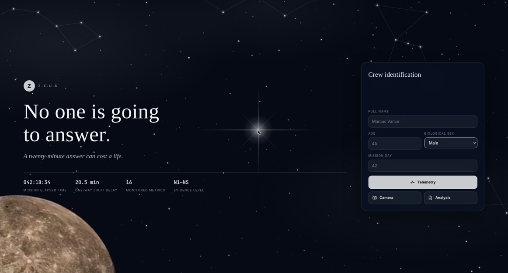
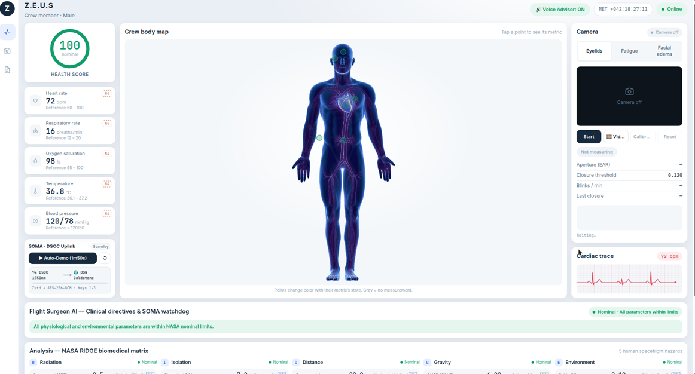
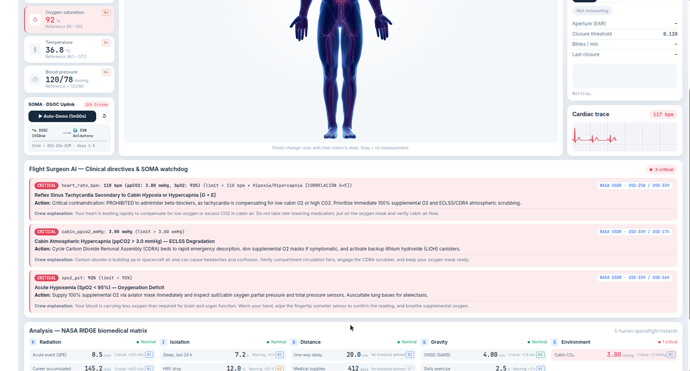
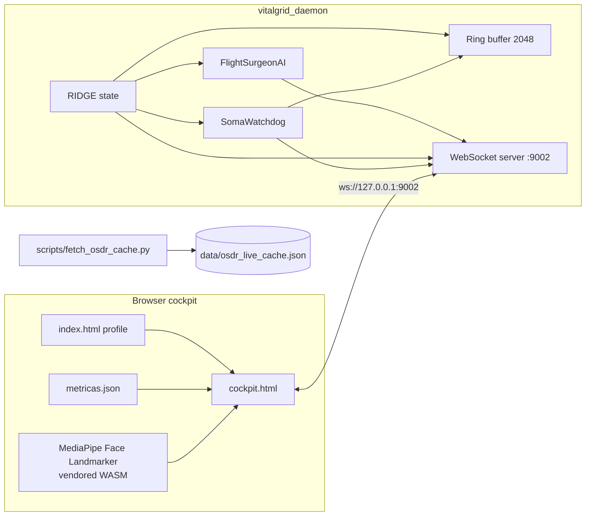

# Z.E.U.S.

**Your health. Beyond Earth.**

Z.E.U.S. is team Z.E.U.S.'s entry for the NASA Space Apps Challenge 2026 challenge *Create Health Monitoring Software for Astronauts on Space Missions*. It is a health-monitoring cockpit for a deep-space transit: a browser interface for the crew and the flight surgeon, fed by a local C++ daemon that streams a simulated biomedical state, scores it, and raises threshold alerts.

The landing page states the premise in the product itself: *"No one is going to answer. A twenty-minute answer can cost a life."*







Screenshots are from a local run: `make`, `./vitalgrid_daemon 9002`, and `python3 -m http.server` in `web/` (Ubuntu, g++ 13.3, Python 3.12). The nominal frame is the live stream at the daemon's resting baseline (health score 100). The alert frame is the same session after the cockpit's crisis shortcut.

[](https://en.cppreference.com/w/cpp/17)
[](https://developer.mozilla.org/docs/Web/JavaScript)
[](https://www.python.org/)
[](https://datatracker.ietf.org/doc/html/rfc6455)
[](https://ai.google.dev/edge/mediapipe/solutions/vision/face_landmarker)
[](https://www.spaceappschallenge.org/)

## The challenge

Beyond low Earth orbit, a round trip to a flight surgeon on Earth can take tens of minutes. The challenge asks for software that helps astronauts and flight surgeons watch crew health during a mission: vitals, trends, and alerts, informed by NASA's open human-research record.

Z.E.U.S. answers that with two processes on one machine:

- a **cockpit** (`web/`) with a crew profile, a body map, a camera, a cardiac trace, clinical directives, and a five-hazard matrix
- a **daemon** (`vitalgrid_daemon`) that owns the telemetry state, the rules, and the emergency archive, and pushes JSON to the browser

There is one cockpit, not two logins. Crew-facing text and flight-surgeon actions share the same screen. The landing buttons Telemetry, Camera, and Analysis scroll to those regions.

## What is implemented

### Cockpit

- Crew identification (name, age, biological sex, mission day) stored in `localStorage` under `zeus.profile`. The mission clock is a client-side counter. On the landing page it starts at day 42, 18:34 and ticks once per second. In the cockpit it restarts from the mission day in the profile.
- Layout and colors come from `web/data/metricas.json`. The HTML does not hard-code clinical thresholds. Each metric names the JSON path on the daemon (`telemetry_ridge.…`), a comparison, a unit, and an evidence label (`N1` official NASA limit, `N2` flight literature, `N3` terrestrial analog, `N4` terrestrial clinical standard, `SF` set by the team).
- Health-score ring, vital-sign cards, and a clickable body map (`web/assets/cuerpo.png`). Points with no sample stay gray.
- Camera panel, off until Start. It loads a vendored MediaPipe Face Landmarker (`web/vendor/mediapipe/`, WASM plus `face_landmarker.task`) and estimates eye aspect ratio, blinks per minute, PERCLOS over 60 seconds, and microsleeps (closures at or above 500 ms). A Facial edema tab compares cheek and jaw widths with a day-1 baseline kept in `localStorage` (`vitalgrid.facialEdema.v1`). A video-file input can stand in for the webcam. Measurements go to the daemon as `{metric, value}` messages.
- Cardiac trace drawn in the browser from `heart_rate_bpm` only. `web/js/ecg.js` generates a PQRST-shaped wave at that rate. The daemon does not send voltage samples.
- Flight Surgeon panel. Each alert shows status, the breached metric, a diagnosis, a tactical action, a crew explanation, and an OSDR accession string. A Voice Advisor button speaks that text with the Web Speech API.
- SOMA / DSOC strip and a scripted Auto-Demo (about 1 minute 50 seconds: nominal, crisis, recovery, SOS). Keys `1`, `2`, `3`, and `0` run the crisis, recovery, SOS, and reset sequences when focus is not in a form field.
- Installable manifest (`web/manifest.json`) with standalone display and the Z.E.U.S icons. Served from `http://127.0.0.1:5500`, Chrome offered an Install prompt.

`web/js/audio_synth.js` is a Web Audio caution-tone class. No page loads it. Spoken alerts use `speechSynthesis` in `web/js/app.js`.

`prototipo-camara/` is an earlier standalone camera page. The cockpit uses `web/js/camara.js`, which keeps the same measurement constants.

### Daemon

C++17, namespace `vitalgrid`. One process, default port **9002**.

- Holds a `RidgePayload`: crew id `CMD-01`, a 0–100 health score, three survival flags, and the RIDGE groups Radiation, Isolation, Distance, Gravity, and Environment.
- Broadcasts that state about once per second over a WebSocket server implemented in `src/network/` (RFC 6455 handshake, no third-party socket library). The listen socket binds `INADDR_ANY`. The log line and the browser both use `ws://127.0.0.1:9002`.
- On a plausible living baseline, the broadcast sample adds a small heart-rate and sensor jitter. The clinical rules run on the unjittered state, so the noise does not accumulate into an alert.
- Accepts text commands from the browser: `TRIGGER_SOS`, `DEPRESSURIZE`, `ASYSTOLE`, `RESET_SURVIVAL`, `RESET_NOMINAL`, and `INJECT_*` for hypoxia, hypercapnia, SANS, solar-particle dose, fever, tachycardia, high and low glucose, sensor fault, and fatigue. It also accepts `{"metric","value"}` for the camera channels and for glucose, ONSD, mood, comm delay, exercise, sleep, and the same vital and cabin fields. The cockpit UI sends the camera metrics and the demo sequences. It does not draw a separate lab form for glucose or mood.
- `FlightSurgeonAI` compares the state with the constants in `src/engine/flight_surgeon.hpp` (acute dose 250 mSv, career dose 600 mSv, blood pressure 155/95 mmHg, heart rate 110 bpm, ONSD 5.8 mm, cabin ppCO₂ 3.0 mmHg, SpO₂ 95%, temperature 38.5 °C, respiratory rate 10 and 24 breaths/min, glucose 65 and 140 mg/dL, sleep 6 h, HRV drop 25%, blink rate 8/min, one microsleep). Some rules combine pillars: a solar-particle dose together with high CO₂, and tachycardia together with hypoxia or hypercapnia. A self-report of `OPTIMAL` while sleep, HRV, blink rate, or microsleeps are already out of range raises `crew_mood_discrepancy`. Values that are non-finite or physiologically impossible return a single `SENSOR_ARTIFACT_REJECTED` warning and skip the other diagnoses for that tick. Alert text in the daemon is Spanish. The cockpit keeps an English catalog and displays that catalog when the metric matches.
- Health score starts at 100 in `src/main.cpp` and is recomputed each tick from fixed penalties in `compute_health_score`. Loss of vital signs forces 0.
- `SomaWatchdog` runs on its own thread. It fires once when vital signs are absent, the SOS flag is set, or cabin pressure is not nominal. It pushes 50 extra copies of the current sample into a 2048-slot ring buffer, then emits a `SOMA_DSOC_EVENT`. Payload size is `samples × 450 + 256` bytes. The compression ratio is the constant 3.65. The nonce and authentication tag are random hex. The record is labeled Zstandard level 19 and AES-256-GCM, and it names a 1550 nm DSOC terminal aimed at the Goldstone 34 m station. Those labels are fields in the JSON. The translation unit does not call a compression or crypto library, and it does not open a radio. The cockpit animates a progress bar from that event. The nominal loop remains 1 Hz. The "1000 Hz" line in the log is the comment on that burst, not a millisecond sampler.

## Architecture



The OSDR cache is not on the live path. The daemon does not open that file. Alert cards carry accession strings compiled into `flight_surgeon.cpp`.

## NASA sources in this repository

| Source | Where it appears |
| --- | --- |
| NASA-STD-3001 | `web/data/metricas.json` cites Vol. 1 Rev. C, V1 4030 for the 600 mSv career bar and NASA-STD-3001 for the 6-hour sleep warning. One crew explanation in `web/js/app.js` repeats the career-limit citation. |
| NASA OCHMO | `metricas.json` attributes the 250 mSv acute solar-event bar to "NASA OCHMO — effective dose per solar event". |
| Five hazard areas | The cockpit heading calls the R, I, D, G, and E groups "5 human spaceflight hazards": radiation, isolation, distance, gravity, environment. That is the shape of the telemetry model. There is no HRP API client. |
| NASA Open Science Data Repository and GeneLab | `scripts/fetch_osdr_cache.py` requests `https://osdr.nasa.gov/osdr/data/search` (`type=cgene`, organism Homo sapiens, project type Spaceflight) and documents `https://genelab.nasa.gov/genelabAPIs`. The checked-in `data/osdr_live_cache.json` says `fetched_at` `2026-11-15T20:45:12Z` and `hits.total` 36. The script refuses mouse-liver accessions OSD-48, OSD-137, and GLDS-242. |
| OSDR accession labels on alerts | `src/engine/flight_surgeon.cpp` writes strings such as `OSD-569 / OSD-483` onto each alert. Those are literals, not a query result. Several of those accessions are also inside the cache. |
| Inspiration4 and the Space Omics and Medical Atlas | Text inside the cached search hits (for example the Inspiration4 T-cell study), not a separate client. |
| Evidence labels in the UI | `metricas.json` also cites confinement analogs, flight literature, and terrestrial clinical ranges, and marks some of them as not validated in microgravity. |

The NASA Twins Study is not referenced. The Canadian Space Agency is not an integration. The word SOMA in the daemon means the team's *Spacecraft Offline Mortality & Anomaly* archive (`src/soma/`). The NASA *Space Omics and Medical Atlas*, also called SOMA, shows up only as publication text inside the OSDR cache.

## Project structure

```
.
├── CMakeLists.txt          # C++17 executable vitalgrid_daemon
├── Makefile                # g++ / clang++, pthread or ws2_32
├── build.bat               # Windows build
├── run.bat                 # Windows: build, HTTP on :8080, daemon on :9002
├── run-zeus.bat            # Windows: static server only, no daemon
├── data/
│   └── osdr_live_cache.json
├── docs/                   # screenshots of a local run
├── scripts/fetch_osdr_cache.py
├── prototipo-camara/       # earlier camera page
├── src/
│   ├── main.cpp
│   ├── models/             # ridge_payload.hpp, alert_payload.hpp
│   ├── engine/             # FlightSurgeonAI
│   ├── soma/               # ring buffer and watchdog
│   └── network/            # WebSocket server
├── tests/                  # Python scripts that speak the socket
└── web/
    ├── index.html          # landing
    ├── cockpit.html
    ├── manifest.json
    ├── css/style.css
    ├── data/metricas.json
    ├── js/                 # app, camera, ECG, facial edema, panel, audio_synth
    ├── assets/             # body map, moon photograph
    ├── iconos/
    └── vendor/mediapipe/   # offline Face Landmarker
```

There is no committed `vitalgrid_daemon` binary. `run.bat` builds it.

## Run it locally

The cockpit uses `fetch()` for `metricas.json`. Opening the HTML file directly (`file://`) fails that request. Serve `web/` over HTTP, and run the daemon if you want numbers instead of "Disconnected".

Verified on Ubuntu 24.04 with g++ 13.3 and Python 3.12:

```bash
make
./vitalgrid_daemon 9002
```

Second terminal:

```bash
cd web
python3 -m http.server 5500
```

Open <http://127.0.0.1:5500/>. Enter a crew profile, choose Telemetry, and wait for the pill to read **Online**. Key `1` injects the cabin-air crisis shown above. Key `0` returns the baseline.

CMake, if you prefer it:

```bash
cmake -S . -B build
cmake --build build
./build/vitalgrid_daemon 9002
```

Windows, from the scripts in the repo: `build.bat` compiles with `g++`. `run.bat` starts `python -m http.server 8080` at the repository root and the daemon, then opens `http://localhost:8080/web/index.html`. `run-zeus.bat` serves only `web/` on port 5500 (or 5501) and does not start the daemon, so the cockpit stays disconnected.

### Checks that passed here

With the daemon already listening on port 9002:

- `python3 tests/test_stream.py` completed a WebSocket handshake and read RIDGE frames (health score 100 at baseline).
- `python3 tests/test_soma.py` received a `SOMA_DSOC_EVENT` after `TRIGGER_SOS`, then sent `RESET_NOMINAL`.
- `python3 tests/test_peripheral_integration.py` starts its own daemon on port 9005 (it picks `vitalgrid_daemon` on Linux and `vitalgrid_daemon.exe` on Windows) and observed blink-rate and microsleep warnings.

`python3 tests/test_flight_surgeon_audit.py` did not start on this machine. It always launches `vitalgrid_daemon.exe`, including on Linux.

`scripts/fetch_osdr_cache.py` rewrites `data/osdr_live_cache.json` from the live OSDR search API. It needs network access to `osdr.nasa.gov`. This README does not refresh that file.

## GitHub Pages

`.github/workflows/pages.yml` publishes the `web/` directory when it runs on `main`. After the workflow is on the default branch, set **Settings → Pages → Build and deployment → Source** to **GitHub Actions**.

That site is the interface. The clinical engine stays on the machine that runs `vitalgrid_daemon`. The page always dials `ws://127.0.0.1:9002`, and a Pages URL is `https://`, so the browser will not open that socket from the hosted page. Use the local HTTP server above for a connected cockpit. Camera capture needs a secure context. `http://localhost` qualifies, and so does HTTPS on Pages. The Face Landmarker files are in the repository, so the model does not download at runtime.

## Team

History on `main` (14–15 Nov 2026):

- **Nicolás Iavicoli Dulcet** (Mar del Plata, Argentina), GitHub [iavicoliNicolas](https://github.com/iavicoliNicolas). He owns this repository. The commit under that account is the merge of pull request #2, `feature/front-cockpit`, on 14 Nov 2026.
- **Clara Culler** (`claritaculler`) built the cockpit the merge brought in: landing page, layout, body map, PWA manifest and icons, ECG trace, and camera panel. She also merged that work and a later landing pass.
- **Nahuel Nuñez** (`nahuelnunez@estudiante.mdp.utn.edu.ar`, UTN) wrote the C++ daemon, the Flight Surgeon rules, the SOMA watchdog, the WebSocket server, the OSDR fetch script, the integration scripts, and the SOMA / Auto-Demo strip in the cockpit.
- Three commits are attributed to Cursor Agent, including an English pass over the cockpit and the wiring of the page to the daemon.

## Resumen en español

Z.E.U.S. es el proyecto del equipo Z.E.U.S. para el desafío de NASA Space Apps Challenge 2026 *Create Health Monitoring Software for Astronauts on Space Missions*. El repositorio junta un cockpit en el navegador (perfil del tripulante, mapa corporal, cámara con MediaPipe en local, trazado cardíaco sintético, directivas clínicas y matriz RIDGE) con un demonio C++17 que publica telemetría simulada por WebSocket en el puerto 9002, evalúa umbrales y, ante SOS, asistolia o pérdida de presión, emite un archivo de emergencia etiquetado como transmisión DSOC. Ese archivo estima el tamaño y usa una razón de compresión fija. No cifra ni comprime de verdad. La caché de OSDR / GeneLab está en `data/` y no la lee el demonio en marcha. Nicolás Iavicoli Dulcet es el dueño del repositorio e integró el cockpit (pull request #2). Clara Culler construyó la interfaz y Nahuel Nuñez el demonio y el motor clínico. Para probarlo: `make`, `./vitalgrid_daemon 9002` y `python3 -m http.server 5500` dentro de `web/`.
